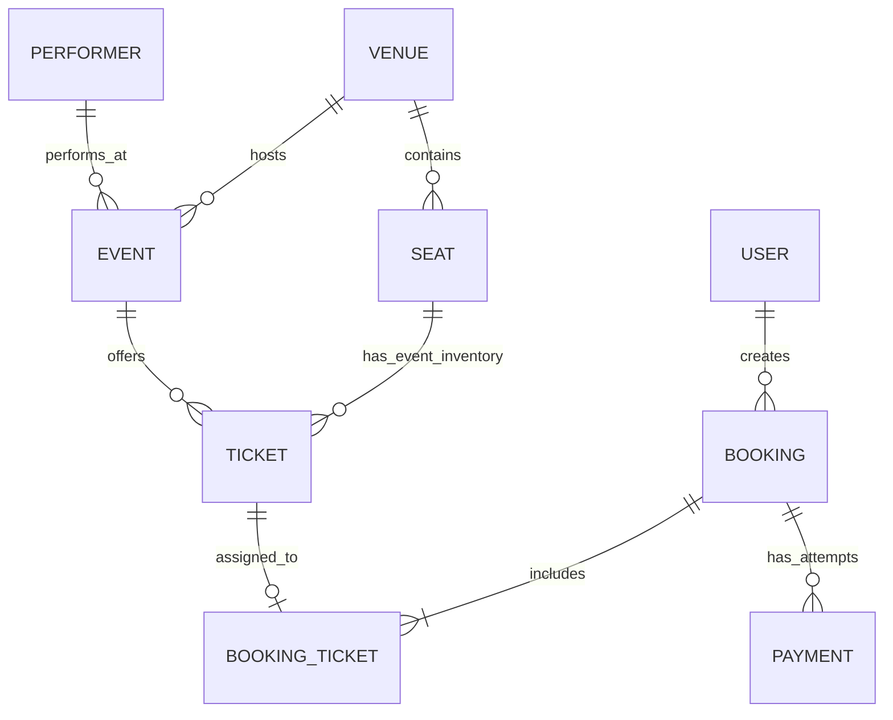
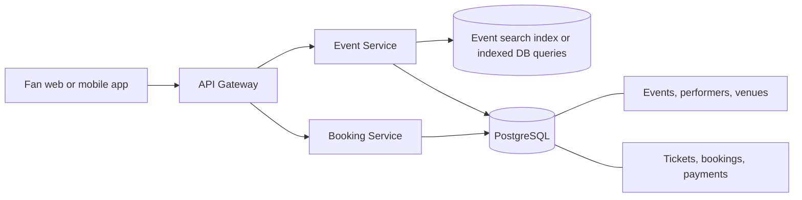

# Fidelity Tickets: Architecture

## Status and reference

This document records the current architecture for Fidelity Tickets, an event ticketing platform for popular concerts with assigned seats.

**Design progress:** requirements, entities, APIs, and baseline high-level design are recorded. The next design task is the reservation deep dive: temporary holds, contention, expiration, and the final database safeguard against double booking.

## Domain model

The model separates the physical seating layout from the event-specific inventory. A venue seat can be reused across different events; a ticket represents the right to occupy that seat for one event.

| Entity | Responsibility |
|---|---|
| Performer | Artist or group associated with one or more events. |
| Venue | Concert location and its seating layout. |
| Seat | Physical position in a venue, identified by section, row, and seat number. |
| Event | A particular performance at a venue and time, associated with a performer. |
| Ticket | Event-specific inventory for a seat, with price and availability/sale state. |
| User | Fan using the platform. |
| Booking | A fan's reservation or purchase attempt for one or more event tickets. |
| Payment | Payment attempt associated with a booking, including provider reference and state. |



The exact relational schema and constraints remain to be designed. In particular, database constraints and transactional updates must support the no-double-booking invariant.

## Initial APIs

These are conceptual API shapes and can change as the design deepens.

### View event and seat map

```http
GET /events/{eventId}
```

Returns event, performer, venue, seating layout, and ticket availability needed to render the event page.

### Search events

```http
GET /events/search?keyword={keyword}&start={date}&end={date}&pageSize={size}&page={number}
```

Returns a paginated list of matching events.

### Initial booking request

```http
POST /bookings
{
  "eventId": "event_123",
  "ticketIds": ["ticket_45", "ticket_46"]
}
```

Returns a `bookingId`. This simple shape is only the starting point. The planned booking design will separate creating a time-limited reservation from confirming a purchase after payment.

## Baseline high-level design



### Event viewing and search

The API Gateway routes read requests to the Event Service. The service returns event and venue information and queries ticket inventory for the seat map. Search begins with indexed database queries; a dedicated search index is an optimization to evaluate in the search deep dive.

Event pages and seat maps are read-heavy. Static information such as event descriptions, performer details, and venue layouts can be cached as the design evolves. Availability changes more often and needs separate freshness decisions.

### Booking

The API Gateway routes booking requests to the Booking Service. In the baseline flow, that service checks ticket availability and updates ticket and booking records in a PostgreSQL transaction. Ticket inventory and booking data share a database because they are tightly coupled by the booking invariant and need an atomic update.

The baseline flow can reject a fan after they have spent time filling out payment details. The next deep dive will introduce a short-lived hold so a seat is reserved during checkout. Payment must not be performed while a database transaction or row lock is held open.

## Planned reservation and payment flow

The design will evolve toward this flow, consistent with the article:

1. Fan requests one or more seats.
2. Booking Service attempts to hold them for a limited checkout window and records a booking in progress.
3. Fan completes payment through a payment provider.
4. The provider sends an authenticated webhook for the payment result.
5. The system confirms the booking and marks tickets sold in a database transaction, with idempotent handling of repeated webhook events.
6. If a hold expires or payment fails, the booking is failed/expired and the seats become eligible for another fan.
7. If payment succeeds after the seat has been reallocated, the system needs a defined compensation path, such as refunding the payment and surfacing the case for reconciliation.

The article explores Redis-backed distributed holds with TTL and a database transaction using row-level locking or optimistic concurrency control as the final protection against double booking. The detailed hold ownership, expiry, and recovery rules are not yet decided; these are the next design items.

## Deep dives still to complete

1. **Reservation and contention:** hold acquisition/release, TTL behavior, multi-seat atomicity, retries, race at expiry, and database safety constraints.
2. **Read scaling:** cache static event data and seat maps; decide how fresh availability must be.
3. **Popular events:** seat map staleness, real-time updates (such as SSE), and a virtual waiting queue to limit admitted booking traffic.
4. **Search:** query patterns, database indexes, and whether a dedicated search system is justified.
5. **Final design and production concerns:** payment reconciliation, observability, failure recovery, security, capacity targets, deployment, backups, and operational runbooks.

## Decisions and open questions

| Topic | Current position | To resolve |
|---|---|---|
| Initial product | Popular concert with assigned seats | Exact sample concert and venue data |
| Core consistency boundary | Ticket and booking updates in one relational database transaction | Schema, isolation, constraints, and retry behavior |
| Hold mechanism | Article's deep dive explores a Redis distributed lock with expiry; database remains the final sale safeguard | Lock key/value model, fencing/ownership, renewal, crash handling, and reconciliation |
| Payment | External provider with webhook-based confirmation | Provider, idempotency strategy, timeout behavior, refunds, and reconciliation |
| Search | Start with indexed SQL queries | Search engine only if requirements/load justify it |
| Peak capacity | Article's 10-million-user example is an aspirational scenario | Define measurable request rate, concurrent users, latency objective, and acceptable queue time |
| Real-time seat updates | Consider SSE in its deep dive | Whether this complexity improves the intended user experience |

